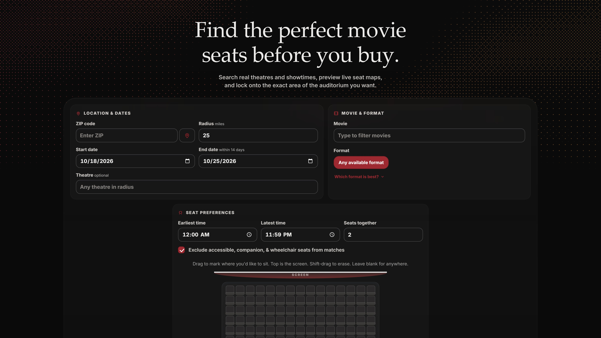

<p align="center">
  
</p>

<h1 align="center">Movie Seat Finder</h1>

<p align="center">
  <em>Find the perfect movie seats before you buy.</em>
</p>

<p align="center">
  <a href="https://github.com/ivan-grebe/movieseatfinder/actions/workflows/tests.yml"></a>
  <a href="LICENSE"></a>
</p>

Movie Seat Finder searches live Fandango showtimes and seat maps, then finds adjacent available seats in the part of the auditorium you choose.

## Features

- Search by ZIP code or your precise browser location.
- Filter by theatre, movie, multiple formats, dates, and times.
- Find adjacent seats in a custom auditorium region.
- Preview seat maps and exclude accessible seats when needed.
- Connect messaging assistants through a public MCP.

## Run locally

Requirements: Python 3.14+, [uv](https://docs.astral.sh/uv/), and Node.js 22+.

```bash
git clone https://github.com/ivan-grebe/movieseatfinder.git
cd movieseatfinder
uv sync --extra test --extra dev
npm ci
npm run build
uv run uvicorn src.server:app --reload --host 127.0.0.1 --port 4173
```

Open [http://127.0.0.1:4173/](http://127.0.0.1:4173/) to use the app.

## Project layout

```text
src/application.py    Website routes and the showtime/seat search
src/fandango.py       Fandango client, caching, and showtime/format normalization
src/seat_matching.py  Adjacent-seat matching on a seat map
src/location.py       ZIP/coordinate lookup and radius filtering
src/share_links.py    Decoding of shared showtime links
src/mcp_server/       MCP tools served at /mcp
src/server.py         Entry point that mounts the website and MCP server
src/scripts/          Browser JavaScript modules
src/styles/           Stylesheets
src/templates/        Server-rendered HTML templates
src/assets/           Fonts, icons, and images served or rendered by the app
src/dist/             Built bundles (generated by npm run build)
tests/                Python and JavaScript tests
```

## MCP integration

The production app exposes a MCP server at `/mcp`.

Agents can pass movie and format hints during discovery, proceed on an unambiguous normalized match, and offer compact nearest-first results with ranked seat groups, a seat map, or a ticket link.

For any MCP client, use:

```text
URL: https://movieseatfinder.com/mcp
Authentication: None
```

## Testing

```bash
npm run build
uv run python -m unittest discover -s tests -v
npm test
uv run ruff check .
uv run ruff format --check .
npm run format:check
npm run lint
npm run knip
```

The Fandango contract test is skipped by default; run it with `LIVE_UPSTREAM_TESTS=1`.

To apply automatic fixes and formatting before opening a pull request:

```bash
uv run ruff check --fix .
uv run ruff format .
npm run format
```

GitHub Actions runs these checks on every pull request, each push to `main`, and daily at 09:17 UTC.

## Support the project

If Movie Seat Finder is useful, consider giving the repository a ⭐. It helps others discover it and supports continued improvements.

## License

Released under the [MIT License](LICENSE).
