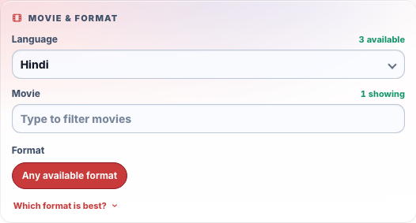

# Movie Language Identification

This document describes how Movie Seat Finder identifies the spoken language for a Fandango showtime and applies the language-first movie filter.

## Source data

Fandango returns language information inside each movie variant's `amenityGroups`. Each group contains an `amenities` array with a `name` and optional `description`, alongside its showtimes. The implementation lives in `src/backend/application.py`.

## Resolution rules

`showtime_language(group)` returns one canonical label. It checks explicit labels across all amenities before checking descriptions, so an unrelated amenity description cannot override an explicit language:

1. `X with Y Subtitles` → `X` (for example, `Hindi with English Subtitles` → `Hindi`).
2. `X Language` → `X` (for example, `Japanese Language` → `Japanese`).
3. `X Dubbed` → `X` (for example, `English Dubbed` → `English`).
4. Descriptions containing `spoken in X`, `presented in X`, or `dubbed in X` → `X` when `X` is a known language. This restriction prevents format descriptions such as `presented in IMAX` or `presented in high definition` from becoming language options. Add new language names to `LANGUAGE_LABELS` when needed.
5. Subtitle/caption-only labels such as `English Subtitles`, `Spanish subtitled`, `Closed caption`, and `Open caption` do not identify spoken language.
6. If no spoken-language evidence exists, the showtime defaults to `English`. This is a compatibility assumption for unlabeled Fandango groups, not confirmation of their spoken language.

Labels are normalized to title case for known languages, including Arabic, Cantonese, English, Hindi, Japanese, Korean, Mandarin, Nepali, Spanish, Tamil, and Telugu. Unknown language names are retained after whitespace cleanup so new Fandango values remain usable.

## Filtering flow

The frontend loads `/api/languages` before `/api/movies`. Selecting a language sends it to `/api/movies`; movies remain in the list when at least one available, non-expired amenity group matches. The same language parameter is passed to `/api/formats` and `/api/search`, so later results cannot reintroduce another language. With an explicit language filter, format options come only from available, non-expired showtimes, including when a group also contains expired or sold-out showtimes in other formats.

Changing the language clears the selected movie, movie input, and dependent format selection before reloading movies.

Saved searches, shared links, and criteria refreshes preserve the selected language. If a language no longer has showtimes, the selection remains visible with a `no showtimes` label; the search is never silently broadened to all languages. Omitting the optional `language` parameter preserves the previous API and URL behavior (`any`).

Saved language names match available options without regard to case, so `hindi` selects `Hindi` without adding a duplicate option. `ANY` selects `Any language`. Backend comparisons preserve non-Latin names so distinct languages cannot match merely because they use non-ASCII characters.

Language-loading failures stop dependent movie loads and show an error beside the language field. Refreshing the criteria retries the load. Responses from superseded language requests cannot update options or trigger another movie load.

## HTTP API

`GET /api/languages` accepts the same location, radius, date range, and theatre parameters as `/api/movies`, and returns `{"languages": ["English", "Hindi"]}`. `radius` is required; provide a ZIP code through `zip`, or coordinates through `lat` and `lon`. Dates use `startDate` and `endDate`.

`/api/movies`, `/api/formats`, and `/api/search` accept an optional, case-insensitive `language` parameter, defaulting to `any`. Seat-search matches include a `language` field. The new endpoint uses the existing validation, upstream-error handling, and rate-limiting conventions.

## Testing and maintenance

Parser cases are in `tests/test_application.py`; the language-first UI flow and movie reset are in `tests/browser.integration.spec.mjs`. When Fandango introduces a new pattern, add a fixture and test before changing the parser. Prefer explicit spoken-language evidence and never infer a spoken language from subtitle or accessibility metadata alone.

## Interface preview

Example captured with controlled language and movie responses.
